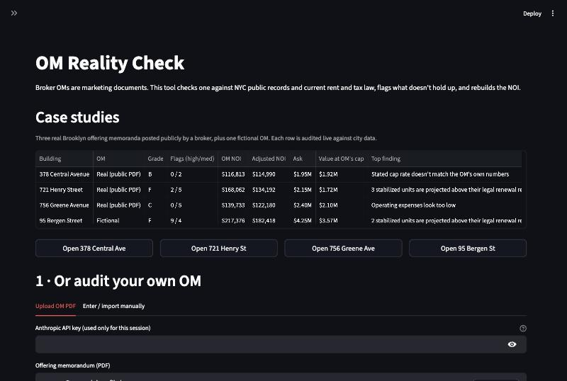
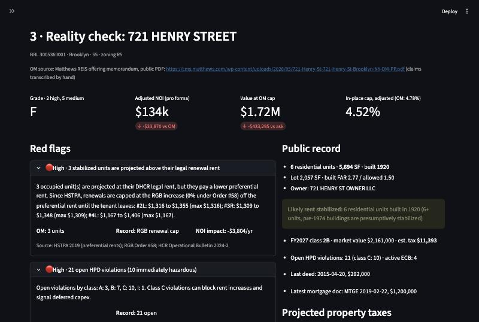
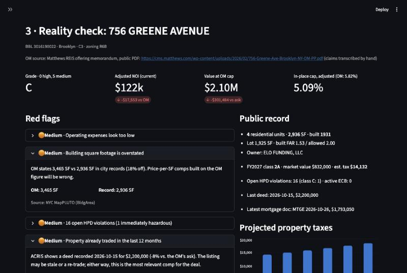
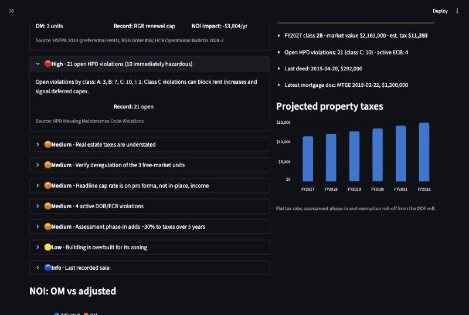
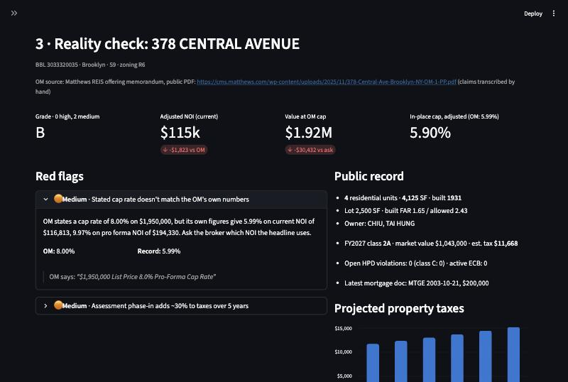

# OM Reality Check

**An automated second opinion on NYC multifamily offering memoranda.**

A broker's offering memorandum (OM) is a marketing document. This tool checks one against
NYC public records and current rent and tax law, flags every claim that doesn't hold up
(with the source), and rebuilds the NOI and value with the corrections.



## Results on real OMs

I ran three real offering memoranda through the tool. A broker posted all three publicly for
Brooklyn walk-ups (Nov 2026). Every finding below comes from live city data, not from the OM.
Full reports: [`examples/`](examples).

| OM | Grade | OM NOI → adjusted | Ask → value at OM's cap | What the tool caught |
|---|:-:|---|---|---|
| [721 Henry St](examples/721_henry_st.md), Carroll Gardens | **F** | $168k → $134k (pro forma) | $2.15M → **$1.72M** | Headline 7.81% cap is on pro forma income (**4.78% in place**). Three stabilized tenants are projected at legal rents above their preferential rents, which HSTPA bars on renewal. **10 open class C HPD violations and $33k in ECB penalties** the OM never mentions. Three "free market" units in a presumptively stabilized 1920 building. Overbuilt lot (FAR 2.77 vs 1.50). |
| [756 Greene Ave](examples/756_greene_ave.md), Bed-Stuy | **C** | $140k → $122k | $2.40M → **$2.10M** | Building SF overstated 18% vs city records. 21% expense ratio. Tax class misstated (2B vs 2A). **ACRIS shows it sold in Oct 2026 for $2.2M**: 8% under the ask, within 5% of the tool's value. |
| [378 Central Ave](examples/378_central_ave.md), Bushwick | **B** | $117k → $115k | $1.95M → $1.92M | The "8.0% pro forma cap" matches neither the OM's own current (5.99%) nor pro forma (9.97%) NOI. Otherwise clean: its air-rights claim checks out against zoning. |

The NOI averaged about 11% lower after the corrections. One deal was graded B, so the tool
isn't just negative: it passes OMs that hold up.

A fourth, [fictional OM](examples/sample_95_bergen.md) on a real building shows every rule
firing at once.

<table>
<tr>
<td></td>
<td></td>
</tr>
<tr>
<td></td>
<td></td>
</tr>
</table>

## What it checks

| Area | Check | Data source |
|---|---|---|
| Physical | Unit count, gross SF, year built | NYC MapPLUTO |
| Zoning | Claimed air rights vs unused FAR; overbuilt lots | MapPLUTO |
| Rent regulation | Likely stabilization (6+ units pre-1974, J-51/421-a); "go to market" upside banned by HSTPA 2019; preferential rents projected to legal rent; RS growth vs RGB Orders #57-58 (incl. the 2026 freeze); renovation premiums vs 2024 IAI caps; free-market units that need DHCR proof | MapPLUTO, DOF exemptions, RGB, NYS HCR |
| Taxes | OM taxes vs DOF roll; 421-a / J-51 expiry in the hold; Class 2A/2B/2C cap phase-in; stated tax class | DOF assessment roll and exemption detail |
| Operations | Expense ratio vs RGB Income & Expense Study; vacancy | RGB I&E Study |
| Pricing | Headline cap on pro forma vs in place; cap math; recent sales; debt vs ask | OM's own numbers, ACRIS |
| Condition | Open HPD violations (class C), active DOB/ECB penalties | HPD, DOB |

The output is a graded report (A-F), flags with NOI impact and sources, a 5-year adjusted
projection (legal rent path, projected taxes, expense floor), the value at the OM's own cap
rate, and a downloadable memo.

## How it works

```
OM PDF ──Claude (structured output, page-cited quotes)──> claims ──> human review ──┐
                                                                                    ├─> 19 rules ─> flags
address ─> GeoSearch (BBL) ─> NYC Open Data (7 datasets) ─> public-record profile ──┘        │
                                                                         corrected underwriting ─> NOI / value
```

| File | Role |
|---|---|
| [`omrc/config.py`](omrc/config.py) | Every policy number (tax rates, RGB orders, IAI caps, benchmarks) with its source, in one place |
| [`omrc/profile.py`](omrc/profile.py) | Builds the public-record profile for a lot |
| [`omrc/rules.py`](omrc/rules.py) | Independent rules; add one by writing a function |
| [`omrc/underwrite.py`](omrc/underwrite.py) | Tax projection, legal rent path, adjusted NOI on a like-for-like basis |
| [`omrc/extract.py`](omrc/extract.py) | PDF to claims with Claude |
| [`app.py`](app.py) | Streamlit app: case studies, review step, report |
| [`scripts/build_examples.py`](scripts/build_examples.py) | Re-runs every example against live data and rewrites `examples/` |

### What real OMs taught the rules

The first version passed a fictional test OM. Real OMs exposed gaps, each now covered by a test:

- **Preferential rents.** 721 Henry projects stabilized units at their DHCR legal rent. Since
  HSTPA, a preferential rent stays the renewal base for the tenancy, so the rule now caps
  occupied units at the RGB increase on the rent actually paid.
- **Pro forma vs in-place cap rates.** OMs headline pro forma caps. The engine now compares like
  with like and estimates in-place NOI when the OM omits it.
- **Stale listings.** 756 Greene had already sold, so the rules now check ACRIS for recent deeds.
- **Free-market claims in old buildings.** These now prompt a DHCR rent-history request.

## Run it

```bash
python3 -m venv .venv && .venv/bin/pip install -r requirements.txt
.venv/bin/streamlit run app.py
```

Open a case study from the front page, or deep-link one: `http://localhost:8501/?case=721_henry_st`.
To read your own OM PDFs, set `ANTHROPIC_API_KEY`. Without a key, you can enter or import the
claims by hand.

```bash
.venv/bin/python -m pytest -q              # 11 offline tests
.venv/bin/python scripts/build_examples.py # refresh examples/ against live data
```

## Limits

This is a screening tool, not an appraisal, legal or zoning opinion.
- Rent-stabilization status is inferred; confirm it with DHCR rent histories.
- Air rights use PLUTO FAR and exclude City of Yes bonuses and zoning lot mergers.
- Taxes hold the rate flat.
- The example OMs were transcribed by hand from the public PDFs linked in each file.
- Results reflect city data as of November 2026.
